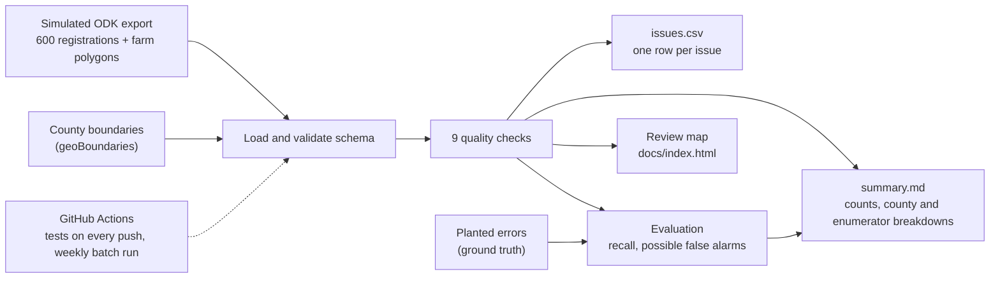

# field-data-quality-kenya

[](https://github.com/Jmos-Mbugua/geo_dqc_pipeline/actions/workflows/tests.yml)
[](https://github.com/Jmos-Mbugua/geo_dqc_pipeline/actions/workflows/scheduled_run.yml)

A Python pipeline that checks farmer registration data from field surveys (attributes, GPS points and farm boundary polygons), reports every issue, and publishes an interactive review map.

> **All farmer data in this repository is simulated.** There are no real farmers, names, ID numbers, phone numbers or farm locations. Only the county boundaries are real (geoBoundaries, public domain).

## The problem

Agricultural insurers and agribusinesses register smallholder farmers through mobile survey tools such as ODK. The data is often messy: GPS points saved as 0,0 or with latitude and longitude swapped, boundaries walked out of order so they cross themselves, farms recorded in the wrong county, the same farmer registered twice, and plots that overlap a neighbour's. These errors flow straight into decisions. A wrong area means a wrong sum insured. A farm in the wrong county gets the wrong weather index or premium zone. Duplicates and overlaps allow double claims, and inaccurate plot geolocation can fail traceability rules such as the EU Deforestation Regulation (EUDR). This project catches those problems before the data is used.

## Live map

**[View the review map](https://jmos-mbugua.github.io/geo_dqc_pipeline/)** (served by GitHub Pages from [docs/index.html](docs/index.html)).
Farms are green (clean), orange (warnings only) or red (at least one error). Click a farm to see its county, crop, area and issues. Popups never show names, national IDs or phone numbers.

## Architecture



## The checks

| Check | What it catches | Severity |
|---|---|---|
| `required_fields_missing` | Blank required fields, including placeholders like "N/A" | error |
| `duplicate_registration` | Records sharing a national ID (error) or a phone number (warning); both records are flagged | error / warning |
| `future_registration_date` | Dates after the survey export date, or dates that are not valid | error |
| `gps_invalid` | GPS at 0,0, outside Kenya's bounding box, or with latitude and longitude swapped | error |
| `gps_outside_county` | GPS point not inside the county the farmer was registered in (spatial join) | error |
| `polygon_invalid` | Missing or non-polygon boundaries; self-intersections (with the location of the problem) | error |
| `farm_area_implausible` | Farms under 0.05 or over 20 acres | error |
| `farm_point_outside_polygon` | Registration point more than 200 m from the farm's own boundary | warning |
| `farm_overlap` | Two farms overlapping by more than 20% of the smaller farm | error |

Every threshold is in [src/fdq/config.py](src/fdq/config.py). Column-by-column rules are in the [data dictionary](docs/data_dictionary.md).

## Results

From the committed run on the seed-42 dataset; [outputs/summary.md](outputs/summary.md) always holds the latest run. Of 600 records, **89.3% are clean**. The pipeline found 76 issues on 64 records, and all 58 planted errors were caught by the check designed for them:

| Check | Planted errors | Recall | Records flagged | Possible false alarms |
|---|---:|---:|---:|---:|
| required_fields_missing | 8 | 8/8 | 8 | 0 |
| duplicate_registration | 6 | 6/6 | 12 | 0 |
| future_registration_date | 5 | 5/5 | 5 | 0 |
| gps_invalid | 8 | 8/8 | 8 | 0 |
| gps_outside_county | 8 | 8/8 | 8 | 0 |
| polygon_invalid | 7 | 7/7 | 7 | 0 |
| farm_area_implausible | 8 | 8/8 | 8 | 0 |
| farm_point_outside_polygon | 0 | n/a | 0 | 0 |
| farm_overlap | 8 | 8/8 | 20 | 0 |

Records flagged can exceed the planted count for expected reasons: both records in a duplicate pair are flagged, and a duplicate also overlaps its original's farm.

**Read these numbers with care.** The errors were planted by this project's own simulator, and the thresholds were chosen knowing what was planted, so 100% recall shows the checks work as designed, not how they would perform on real field data. The simulated clean records are cleaner than real ones (no GPS drift between neighbours, for example), which is why there are no false alarms. Real data would need the thresholds tuned against records a person has reviewed.

## Run it locally

Requires Python 3.11+ (developed on 3.13). From the cloned repository:

```powershell
python -m venv .venv
.venv\Scripts\activate                 # macOS/Linux: source .venv/bin/activate
pip install -r requirements.txt -e .
python -m fdq.run                      # writes outputs/issues.csv, outputs/summary.md, docs/index.html
```

Run `pytest` for the tests, and `python -m fdq.run --help` for options. The pipeline exits with code 1 if input files are missing or the schema is wrong.

## Design decisions

- **Areas and distances in metres, never degrees.** Data stays in EPSG:4326 (as ODK produces it). Each farm is reprojected to its own UTM zone (Arc 1960 / UTM 36S or 37S, split at 36°E) before measuring. Point-in-polygon and intersection *tests* run in degrees, because they don't measure anything.
- **Configurable thresholds.** Every limit is a named constant in one file, documented with its reasoning.
- **Evaluation against planted errors.** A reproducible simulator (`--seed`) plants ten error types in about 10% of records and writes a separate ground-truth file. The checks never read it; `fdq.evaluate` scores recall and possible false alarms per check.
- **Each check owns one problem.** A check skips records another check already reports (for example, no area is computed for an invalid polygon), so one bad value doesn't produce a cascade of misleading flags.
- **Privacy by design on the map.** Only farmer_id, county, crop, area and issues reach the map. Identifiers are redacted from messages, all values are HTML-escaped, and a test scans the generated HTML for any name, ID or phone number.
- **Tests and CI.** 141 pytest tests run on small hand-made fixtures (every check has a catching case and a clean case), plus an end-to-end pipeline test. GitHub Actions runs them on every push. A weekly workflow generates a new batch, runs the pipeline, uploads the outputs and commits the refreshed map and summary.

## Limitations

- The data is simulated; the checks have not been run on real survey data.
- Ward names are not checked against ward boundaries, and the duplicate check matches on ID and phone only, not on similar names.
- Farms are not checked against land cover, so a farm placed in a lake or forest reserve is not flagged.

## What I would add next

- **PostGIS storage.** Load registrations and farms into PostgreSQL/PostGIS so the checks can run as spatial SQL over the full history, with indexes, rather than over files.
- **EUDR deforestation check.** For commodities in scope such as coffee, flag farm polygons that overlap land that was forest on the regulation's cutoff date (31 December 2020), using a public forest-cover layer such as the EU JRC Global Forest Cover 2020 map.
- **Incremental loads.** Process only new or changed submissions since the last run, while still checking new farms against existing ones for duplicates and overlaps.

## Repository layout

| Path | Contents |
|---|---|
| `src/fdq/` | Package: `checks.py`, `pipeline.py`, `evaluate.py`, `map.py`, `geo.py` (CRS helpers), `config.py`, `synthetic/` (simulator) |
| `tests/` | pytest suite |
| `scripts/` | Download county boundaries; generate a simulated survey |
| `data/raw/` | County boundaries, simulated registrations and farms, planted-error ground truth |
| `outputs/` | `issues.csv` and `summary.md` from the latest run |
| `docs/` | Review map (`index.html`) and [data dictionary](docs/data_dictionary.md) |

MIT licensed. County boundaries: [geoBoundaries](https://www.geoboundaries.org) gbOpen ADM1 (public domain).
